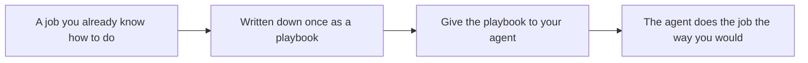

# Playbooks

A playbook is a job you already know how to do, written down once. Give that playbook to your agent. The agent does the job the way you would, and respects that pattern on every run.

One skill runs every playbook, in ChatGPT, Claude, or Cursor.



Three files make that work:

- [rules/fill.md](rules/fill.md) is the contract for every run: cite sources, label estimates, and do not leave a section blank.
- [skills/run-playbook/SKILL.md](skills/run-playbook/SKILL.md) is the loop: pick the playbook, ask, follow its steps, return the result.
- [catalog.json](catalog.json) is the index. Playbooks sit in three categories: **Validation**, **Planning**, and **Growth**. A request is matched to a ready playbook. A stub is skipped. If two ready playbooks both match, the agent asks which one and names the category.

## Playbooks

| Category | Id | What it returns | Ask for it with |
|---|---|---|---|
| Validation | `idea-validator` | A scorecard on pain, market, alternatives, and customer pull, with one next test. | "Validate my idea" |
| Validation | `customer-discovery` | The best-fit customer, where to recruit, screening, a non-leading interview guide, and an evidence table from your own notes. | "Plan customer interviews" |
| Validation | `market-research` | Market definition, segments, bottom-up TAM, SAM, and SOM with formulas and a range, trends, demand signals, and an attractiveness verdict. | "Do market research" |
| Planning | `business-plan` | A business plan in eight sections with a revenue chart. | "Write a business plan" |
| Planning | `mvp-planner` | First users, the user journey, now, later, and never features, user stories, manual steps, a time-boxed build plan, and launch metrics. | "Plan the MVP" |
| Planning | `financial-model` | Monthly revenue, costs, and cash with a cash chart, runway, break-even, unit economics, scenarios, and reconciliation. | "Build a financial model" |
| Growth | `go-to-market` | Positioning, buyer roles, offer, channel tests with a budget chart, a launch plan, and one primary metric. | "Write a go-to-market plan" |
| Growth | `lead-generation` | A sales hypothesis, qualification and scorecard, lawful lead sources, an outreach sequence, a funnel chart, and the outreach rules for your country. | "Build a lead generation plan" |

They work alone or in order: validate the idea, talk to customers, size the market, plan the MVP, plan the launch, find leads, then model the money. When you already ran one, paste its result into the next request and the agent reuses those facts instead of asking again.

Each playbook asks for a **country** (`market_country`) and a **focus region** (`target_region`): a city, province or state, metro, or the whole country. That scopes research, competitors, events, and outreach. The business plan also has **Location** for where the company is based; **Region** is where the market work focuses.

The methods come from Y Combinator and the sources it points founders to: [How to talk to users](https://www.ycombinator.com/library/JQ-how-to-start-a-startup-talking-to-users) and [The Mom Test](https://www.momtestbook.com/) for interviews, [How to plan an MVP](https://www.ycombinator.com/library/6f-how-to-plan-an-mvp) and [Do Things That Don't Scale](https://paulgraham.com/ds.html) for the first version and first customers, [Enterprise sales for founders](https://www.ycombinator.com/library/LF-enterprise-sales-for-founders) for outreach, and [Default Alive or Default Dead?](https://www.paulgraham.com/aord.html) for the model. The shared guides in [research/](research/) hold the details.

No playbook invents an interview, a contact, a quote, or a figure. Anything not given by you or found on an opened page is labeled `Assumption:`. Lead generation writes messages for you to review and send; it does not send them.

## Use it

Paste this into ChatGPT, Claude, or a Cursor agent chat. One link is enough. The skill fetches the rules, the catalog, and the playbook files.

```text
Follow https://raw.githubusercontent.com/foundrvibe/playbooks-for-agents/main/skills/run-playbook/SKILL.md

Create a business plan for ZedCut, a bilingual B2B SaaS for countertop fabrication shops in Canada.
```

Replace the second line with your own request. If several playbooks match, the agent asks which one and names the category.

To choose the playbook yourself, name its id. The agent uses that playbook and does not match intents.

```text
Follow https://raw.githubusercontent.com/foundrvibe/playbooks-for-agents/main/skills/run-playbook/SKILL.md

Playbook: business-plan
Describe the company or idea here.
```

Use any id from the table above in place of `business-plan`, for example:

```text
Follow https://raw.githubusercontent.com/foundrvibe/playbooks-for-agents/main/skills/run-playbook/SKILL.md

Playbook: customer-discovery
ZedCut, a bilingual B2B SaaS for countertop fabrication shops in Canada. No interviews yet.
```

A raw URL to `template.md`, `schema.json`, or the playbook folder selects it the same way. Replace `main` with a version tag to pin that playbook.

<details>
<summary>Add a playbook</summary>

1. Copy `playbooks/_starter/` to `playbooks/<category>/<id>/`. Set `x-id` in `schema.json` to the new id. Set `title` and `description` in `description.json`, and set `x-title` to that same title.
2. Edit `template.md`, `schema.json`, and `example.json`. `template.md` is the result. Mark each field `x-source` as `user`, `user_data`, `derived`, or `research`.
3. In `research.md`, write `## Steps` in the order a person would do the job. Name every `research` field and link the shared guide as `../../../research/<name>.md`. Add a new shared guide only when none fits.
4. Add a catalog entry with `id`, `name`, `version`, `status`, `category`, `description`, `intents`, and the file paths. `name` is the `description.json` title. `description` is the `description.json` description. `category` must be an id in `categories`, and that category's `templates` list must include the new id. Create a category when none fits. Set `status` to `ready` and fill `intents` when a request should select it. Leave `intents` empty while it is a stub.
5. Run `npm ci && npm run validate`.

No new skill is required. CI fails if two ready playbooks share an intent, if `research.md` misses `## Steps` or a research field, or if the example does not pass the fill check.

</details>

<details>
<summary>Pin a version</summary>

Each playbook version is tagged as `<id>-v<version>`, for example `business-plan-v4.0.0`. Replace `main` in any raw URL with the tag to keep a fixed shape:

`https://raw.githubusercontent.com/foundrvibe/playbooks-for-agents/business-plan-v4.0.0/playbooks/planning/business-plan/template.md`

A tag pins the rules and skill at that commit too. A breaking schema change gets a new major version.

</details>

<details>
<summary>Check a fill</summary>

Save the JSON the agent returns, and optionally its Markdown, then run:

```text
npm ci
node scripts/check-fill.mjs business-plan fill.json filled.md
```

It fails when the JSON does not match the schema, the Markdown still has an unknown marker or a placeholder, `sources` is empty in `web` mode, or a number in the Markdown is not in the JSON. Without `filled.md`, it renders the JSON with `scripts/render-fill.mjs` first.

</details>

<details>
<summary>Test contexts</summary>

[tests/contexts/](tests/contexts/) holds real contexts, such as `zedcut.json`, plus one `zedcut-<id>.json` per playbook. The `template` field names the playbook. Paste its `context` into each agent, save the fill, and add `--expect tests/contexts/<file>.json` to the check to compare the fields it lists.

</details>

<details>
<summary>What comes back</summary>

The agent returns only the finished result. Sources are inside that result. The field values stay in the agent's check and are not pasted after it.

</details>

<details>
<summary>Charts</summary>

Comparable items go in a table. When that table has two or more numbers that share a unit, a chart of those same numbers sits under the table.

- **Agents that can run Python** (ChatGPT data analysis, Claude code execution, Cursor) draw each chart with [charts/render_chart.py](charts/render_chart.py). The colors and size come from [themes/default.json](themes/default.json).
- **Agents that can't run Python** write a Mermaid chart under the same table.

To draw one yourself:

```text
pip install matplotlib
python charts/render_chart.py --kind mermaid-xy --data '{"seriesName": "Revenue", "x": ["Year 1", "Year 2"], "series": [120000, 260000]}' --currency CAD --language fr --out financials.png
```

</details>
